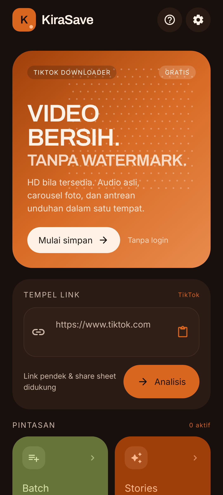
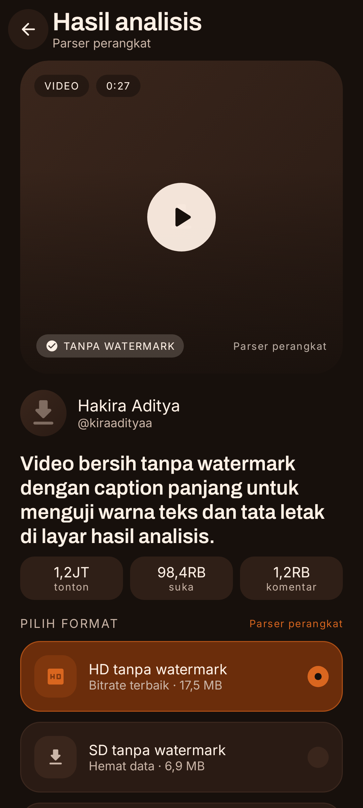
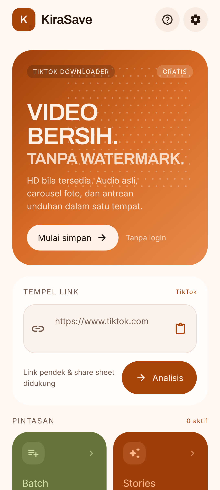
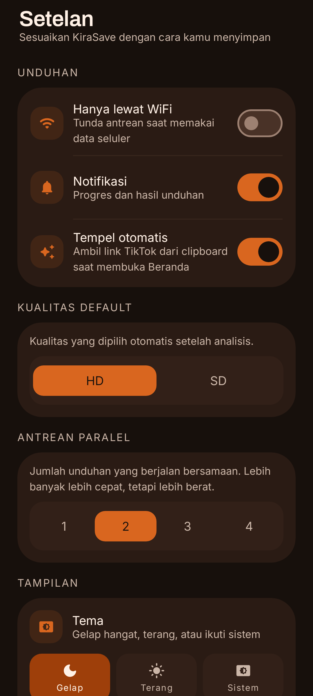
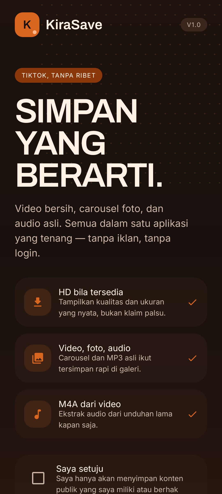
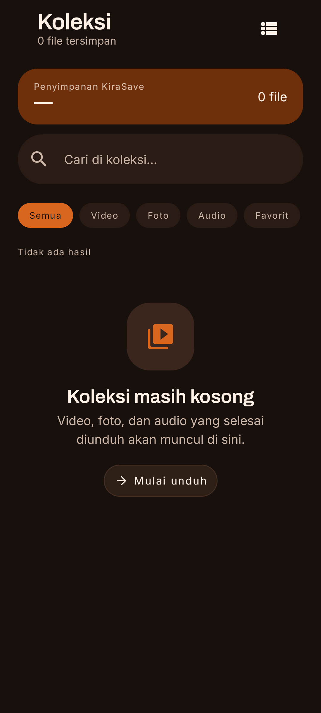
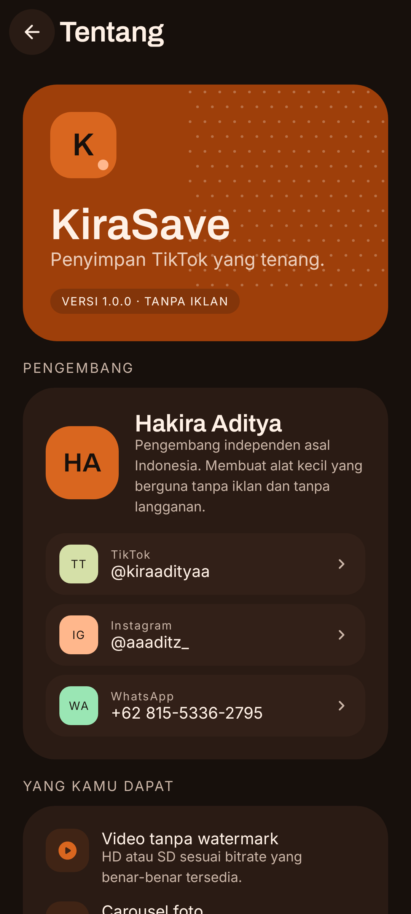

# KiraSave

**Penyimpan media TikTok yang bersih, tenang, dan tanpa iklan.**

A no-ads, open-source TikTok media downloader for Android — built with Kotlin, Jetpack Compose, and Material 3.

[](https://github.com/ArchDityaa/KiraSave/actions/workflows/android-ci.yml)
[](https://github.com/ArchDityaa/KiraSave/releases)
[](LICENSE)
[](https://developer.android.com)
[](https://kotlinlang.org)
[](https://developer.android.com/jetpack/compose)

<p align="center">
  
  
  
</p>

## Kenapa KiraSave?

KiraSave dibuat untuk satu pekerjaan yang jelas: menyimpan video, carousel foto, dan audio TikTok ke galeri perangkat tanpa iklan, tanpa akun, dan tanpa langganan.

- **Tanpa watermark** — memilih stream bersih dari sumber, bukan menempel ulang video ber-watermark.
- **Jujur soal kualitas** — menampilkan bitrate dan ukuran yang benar-benar tersedia. Tidak ada klaim 1080p palsu.
- **Hybrid engine** — parser on-device dicoba lebih dulu; API publik gratis menjadi cadangan.
- **Tidak ada tracking** — tanpa Firebase, AdMob, analytics, atau SDK berbayar.
- **Dibuat untuk dipakai** — antrean, jeda, favorit, pencarian, batch, pemutar bawaan, dan penyimpanan galeri yang rapi.

## Fitur

| Kategori | Kemampuan |
|---|---|
| Video | Unduh MP4 tanpa watermark, pilihan HD/SD sesuai bitrate sumber |
| Foto | Simpan seluruh slide carousel ke `Pictures/KiraSave` |
| Audio | MP3 asli dari postingan, serta ekstrak M4A dari video tanpa re-encode |
| Analisis | Clipboard, share sheet, deep link, input manual, dan batch hingga 20 link |
| Unduhan | Antrean, progres real-time, jeda, lanjut, batal, coba lagi, 1–4 paralel |
| Koleksi | Riwayat, pencarian, filter tipe/favorit, buka, bagikan, hapus |
| Pemutar | ExoPlayer + kontrol Compose, kecepatan 1×–2×, lompat ±10 detik |
| Stories | Stories publik, bersifat kondisional sesuai ketersediaan endpoint |
| Tampilan | Material 3, tema gelap hangat/terang/sistem, responsif ponsel–tablet |
| Privasi | Tanpa login, tanpa iklan, tanpa analytics, konten publik saja |

## Tangkapan layar

Semua gambar dihasilkan oleh **Roborazzi** pada JVM, bukan mockup. Lihat [dist/screenshots](dist/screenshots) untuk matriks lengkap 320dp/360dp, tema gelap/terang, dan animasi pill navigasi.

| Beranda | Hasil analisis | Setelan |
|---|---|---|
|  |  |  |

| Onboarding | Koleksi | Tentang |
|---|---|---|
|  |  |  |

## Instalasi

### Unduh APK

Buka halaman **[Releases](https://github.com/ArchDityaa/KiraSave/releases/latest)** dan unduh `KiraSave-1.0.0.apk`.

- Minimum Android 8.0 (API 26)
- Target/compile SDK 36
- APK ini adalah **debug build untuk sideload**, bukan build Play Store
- Aktifkan **Instal dari sumber tidak dikenal**, lalu buka APK

SHA-256 rilis 1.0.0:

```text
627d30e2792e41ef88fb88455540fa9a83fa2b452839afcf948b8fdb1dd9a522
```

### Build dari source

Prasyarat:

- JDK 17
- Android SDK platform 36 + build-tools yang sesuai
- Gradle wrapper sudah disertakan (**Gradle 8.13**; jangan memakai Gradle 9.x dengan AGP 8.13.2)

```bash
git clone https://github.com/ArchDityaa/KiraSave.git
cd KiraSave
./gradlew assembleDebug
```

APK dihasilkan di:

```text
app/build/outputs/apk/debug/app-debug.apk
```

## Arsitektur

```text
Compose UI (Material 3)
        │
        ▼
MainViewModel ──────────────┐
        │                   │
        ▼                   ▼
TikTokRepository       DownloadEngine
  ├─ on-device parser      ├─ queue + concurrency
  └─ TikWM fallback        ├─ foreground service
        │                  ├─ OkHttp streaming
        ▼                  ├─ Room progress
   TikTokMedia             └─ MediaStore
        │
        ▼
Room + DataStore + MediaStore
```

- **UI:** Jetpack Compose, Material 3, Navigation Compose, responsive bottom bar/rail.
- **State:** MVVM dengan `StateFlow` dan `MainViewModel`, input share diteruskan ke Beranda.
- **Penyimpanan:** Room untuk riwayat/antrean, DataStore untuk setelan, MediaStore untuk galeri.
- **Jaringan:** OkHttp; parser halaman TikTok + fallback TikWM tanpa API key.
- **Unduhan:** foreground service `dataSync`, progres tersimpan, file sementara `.part`.
- **Pemutar:** Media3 ExoPlayer + `media3-ui-compose`, kontrol sepenuhnya di Compose.
- **Pengujian visual:** Roborazzi + Robolectric, tanpa emulator.

Penjelasan lebih dalam: [docs/ARCHITECTURE.md](docs/ARCHITECTURE.md).

### Struktur repository

```text
app/src/main/java/com/hakira/kirasave/
├── data/       # API, Room, unduhan, MediaStore, audio, service
├── ui/
│   ├── components/   # design system dan komponen bersama
│   ├── screens/      # onboarding, home, result, batch, stories, player, dll.
│   ├── theme/        # warna, tipografi, Material 3
│   ├── KiraSaveRoot.kt
│   └── MainViewModel.kt
├── KiraSaveApp.kt
└── MainActivity.kt
```

## Pengujian

```bash
./gradlew testDebugUnitTest      # unit + visual test
./gradlew lintDebug              # Android lint
./gradlew assembleDebug          # build APK
./gradlew recordRoborazziDebug   # rekam ulang screenshot
./gradlew verifyRoborazziDebug   # bandingkan screenshot
```

Screenshot test mencakup onboarding, Home, Result, Downloads, Library, Settings, About, Privacy, serta animasi pill navbar pada 320dp/360dp dan tema gelap/terang.

## Privasi & disclaimer

- KiraSave tidak berafiliasi dengan TikTok, ByteDance, atau TikWM.
- Hanya konten publik yang didukung. Video privat, login-only, atau dibatasi wilayah tidak diproses.
- URL hanya dikirim ke TikWM saat parser on-device gagal.
- Pengguna bertanggung jawab penuh atas hak cipta dan kepatuhan hukum.
- Tidak ada jaminan kualitas 1080p; kualitas mengikuti bitrate yang tersedia.
- Stories dapat berhenti tersedia kapan saja karena bergantung pada endpoint publik gratis.

Baca [PRIVACY.md](PRIVACY.md) dan [DISCLAIMER.md](DISCLAIMER.md).

## Kontribusi

Kontribusi terbuka untuk siapa saja. Baca [CONTRIBUTING.md](CONTRIBUTING.md) dan [CODE_OF_CONDUCT.md](CODE_OF_CONDUCT.md) sebelum membuka pull request.

Ide yang paling dibutuhkan:

- Uji perangkat nyata pada Android 8–16, terutama gesture navigation dan penyimpanan legacy.
- Perbaikan parser TikTok saat struktur halaman berubah.
- Aksesibilitas: TalkBack, kontras, ukuran teks besar.
- Terjemahan dan dokumentasi.
- Test untuk download engine, retry, dan deduplikasi.

## Lisensi

Kode aplikasi dilisensikan di bawah **Apache License 2.0**. Lihat [LICENSE](LICENSE).

Font Archivo dan Inter menggunakan **SIL Open Font License 1.1**. Dependensi pihak ketiga dijelaskan di [THIRD_PARTY_NOTICES.md](THIRD_PARTY_NOTICES.md).

## Pengembang

**Hakira Aditya**

- TikTok: [@kiraadityaa](https://www.tiktok.com/@kiraadityaa)
- Instagram: [@aaaditz_](https://instagram.com/aaaditz_)
- WhatsApp: [+62 815-5336-2795](https://wa.me/6281553362795)

---

Dibuat dengan sabar di Indonesia. Jika KiraSave berguna, beri bintang pada repository ini.
