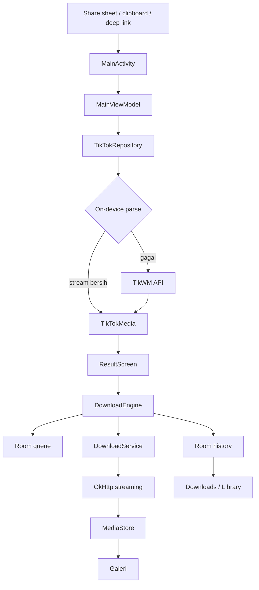

# Arsitektur KiraSave

Dokumen ini menjelaskan bagaimana KiraSave bekerja, keputusan desain utama, dan area yang perlu diperhatikan saat mengembangkan lebih lanjut.

## Ringkasan

KiraSave adalah aplikasi Android single-activity dengan UI Jetpack Compose dan arsitektur MVVM sederhana. Tidak ada backend milik proyek. Semua metadata, antrean, dan file disimpan di perangkat.

## Lapisan

### `data/`

| File | Tanggung jawab |
|---|---|
| `TikTokRepository.kt` | Normalisasi URL, parser on-device, fallback TikWM, parsing metadata/Stories |
| `DownloadEngine.kt` | Antrean, konkurensi, progres, pause/resume/retry, deduplikasi, ekstraksi audio |
| `DownloadService.kt` | Foreground service `dataSync`, notifikasi progres |
| `DownloadDao.kt` / `DownloadEntity.kt` | Persistensi riwayat dan status ke Room |
| `MediaStoreSaver.kt` | Simpan/buka/bagikan/hapus file melalui MediaStore atau legacy path |
| `AudioExtractor.kt` | Copy track audio ke M4A via MediaExtractor + MediaMuxer |
| `SettingsRepository.kt` | DataStore untuk tema, kualitas default, WiFi-only, dsb. |
| `Models.kt` | Model domain dan helper format |

### `ui/`

- `MainViewModel` menyatukan state dari repository dan engine menjadi `StateFlow`.
- `KiraSaveRoot` mengatur onboarding, navigasi, bottom bar/rail, snackbar, dan overlay player.
- `screens/` berisi layar; `components/` berisi design system dan komponen reusable.
- `theme/` mendefinisikan palet warm-dark/light, tipografi Archivo + Inter, dan shapes.

## Alur analisis hybrid

1. **Normalisasi input**
   - Menerima URL `tiktok.com`, `vm.tiktok.com`, `vt.tiktok.com`, ID numerik, atau teks share.
   - Short link di-resolve dengan `HEAD`/`GET` dan validasi host.
2. **Parser on-device**
   - Mengambil HTML halaman publik.
   - Membaca `__UNIVERSAL_DATA_FOR_REHYDRATION__` atau `SIGI_STATE`.
   - Hanya menerima stream dari `video.bitrateInfo` jika tersedia; memilih bitrate tertinggi yang bersih.
   - Jika tidak yakin, tidak memakai `playAddr` yang berpotensi ber-watermark.
3. **Fallback TikWM**
   - `GET https://www.tikwm.com/api/?url=...&hd=1`
   - Rate limit internal sekitar 1.05 detik dan retry untuk 403/429/5xx.
   - URL hanya dikirim ke pihak ketiga pada langkah ini.

Parser TikTok rapuh terhadap perubahan halaman. Fallback sengaja dipisah agar kegagalan parser tidak mematikan seluruh fitur.

## Alur unduhan

1. `DownloadEngine.enqueue` memvalidasi format, mengecek duplikat selesai, lalu menulis entitas `QUEUED` ke Room.
2. `pump()` menjalankan maksimal `maxConcurrent` job dan memulai `DownloadService` hanya saat ada job yang benar-benar berjalan.
3. OkHttp menulis stream ke cache `.part` sambil memperbarui Room setiap ~300ms.
4. Setelah selesai, file dipindahkan ke MediaStore (`Movies`, `Pictures`, atau `Music`), status menjadi `COMPLETED`, dan notifikasi ditampilkan.
5. `invokeOnCompletion` membersihkan job dan memanggil `pump()` lagi; service berhenti saat antrean dan job aktif kosong.
6. Pause/cancel membatalkan call dan job. Karena file sementara dihapus, resume/retry memulai dari awal.

### Status

`QUEUED → DOWNLOADING → COMPLETED`
`DOWNLOADING → PAUSED → QUEUED`
`DOWNLOADING → FAILED / CANCELLED`
`FAILED / CANCELLED → QUEUED` (retry)

### Deduplikasi

- Video/audio dicek berdasarkan `videoId` + kualitas.
- Foto dicek per indeks carousel (`videoId-index`) agar satu carousel tidak tersimpan ganda.
- Balapan enqueue ganda sebelum salah satu selesai masih mungkin terjadi; ini kandidat perbaikan.

## Penyimpanan

- **Room** `kira_save.db`: riwayat, status, progres, favorit.
- **DataStore** `kira_settings`: tema, kualitas default, WiFi-only, notifikasi, auto-paste, onboarding.
- **MediaStore**: file publik. API 29+ memakai `IS_PENDING`; API 26–28 memakai path eksternal + media scan.
- **FileProvider**: berbagi/buka file dengan authority `${applicationId}.fileprovider`.

## UI dan navigasi

- Satu `NavHost` stabil; tab utama memakai `saveState`/`restoreState`.
- Ponsel: bottom bar horizontal dengan satu pill oranye yang meluncur dan melebar.
- Tablet ≥840dp: navigation rail.
- Player dirender sebagai overlay di root, bukan mengganti `NavHost`, agar state navigasi tidak hilang.
- Warna teks mengandalkan root `Surface(contentColor = onBackground)`; hindari `Text` tanpa warna di dalam surface transparan.
- Semua layar utama memakai padding bawah kecil karena bottom bar sudah memesan ruang di layout, bukan overlay.

## Pengujian

- `VisualRegressionTest` merender Compose di JVM dengan Robolectric native graphics.
- Screenshot disimpan di `app/build/outputs/roborazzi/`; salinan review ada di `dist/screenshots/`.
- Cakupan: onboarding, Home, Result, Downloads, Library, Settings, About, Privacy, navbar 320/360dp, tema gelap/terang, dan frame bounce.
- Tidak ada emulator/ADB di lingkungan pengembangan; uji perangkat nyata masih dibutuhkan.

## Batasan teknis

- Kualitas media sepenuhnya bergantung pada sumber.
- Stories bergantung pada endpoint publik yang dapat berubah/rate limit.
- M4A hanya menyalin track audio; codec yang tidak didukung MediaMuxer akan gagal dengan pesan jelas.
- Pause/retry belum melanjutkan byte-range.
- Parser on-device membutuhkan HTML yang dapat diakses; Challenge/redirect akan jatuh ke fallback.
- APK publik saat ini adalah debug build; belum ada signing config release.

## Kandidat pengembangan

Lihat [ROADMAP.md](ROADMAP.md).
